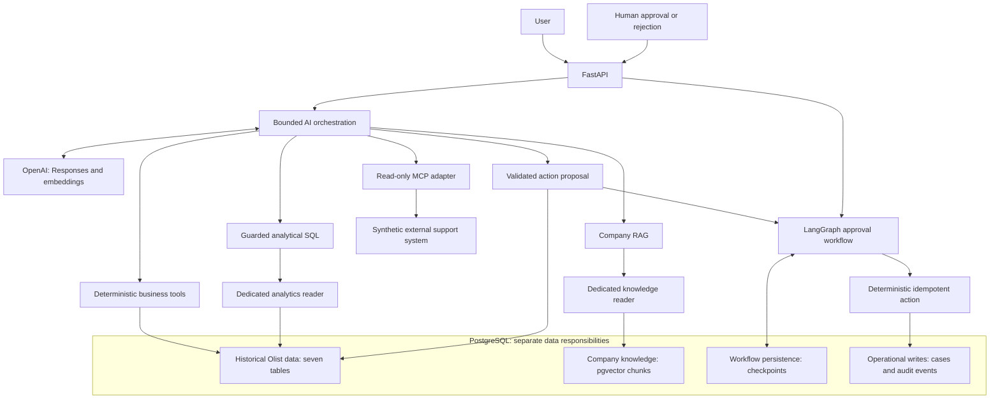

# Enterprise AI Operations Agent

A production-oriented AI assistant that helps an e-commerce operations team answer business questions, find company guidance, and request internal reviews with human approval.

## What this project does

Users ask ordinary-language questions about orders, customers, payments, business trends, internal company procedures, and support issues. They can also request an internal review of an order.

The system chooses the appropriate controlled data source or capability for each question: business records for facts, analytical queries for trends, company documents for procedures, or a support service for ticket context. A review request becomes a proposal awaiting a human decision.

The language model does not receive unrestricted database or business-action access. Database queries, analytics, document searches, external support access, and business actions each pass through application-controlled validation and permissions. **Business actions require human approval before execution.**

The business data comes from the **Brazilian E-Commerce Public Dataset by Olist**: historical, anonymized e-commerce records. Company procedures are authored demo documents, and support tickets are synthetic examples rather than a live customer support system.

This is a reference implementation with production-style safeguards, not a claim of complete production readiness.

## Example questions and use cases

| Question | What the system does |
| --- | --- |
| “How many orders were canceled?” | Counts historical orders by status: 625 were canceled. |
| “Show this customer's order history.” | Finds orders across records belonging to the same customer. |
| “What is the financial breakdown for this order?” | Calculates item prices, freight, and recorded payment totals. |
| “Which product categories have the highest sales value?” | Runs a checked analytical query over historical data. |
| “What does company policy say about payment discrepancies?” | Searches demo company procedures and identifies the supporting sections. |
| “Are there support issues associated with this order?” | Retrieves clearly labeled synthetic support-ticket context. |
| “Create an internal review request for this order.” | Prepares a review proposal; a human must approve it before a case is created. |

The supported business action is an **internal order review case**. The assistant does not cancel orders, issue refunds, contact customers, or modify support tickets.

## Key capabilities

- **Seven controlled assistant tools** for business facts, flexible analytics, company guidance, support context, and review proposals.
- **Saved approval workflows:** pending requests persist across restarts, and retries do not create duplicate business records.
- **Separate data access:** historical records, company documents, support tickets, and new review cases have distinct access paths.
- **Verified baseline:** 1,114 passing tests and 312 deterministic evaluation checks.
- **Reproducible runtime:** Docker/Compose packaging and verified setup from an empty database.
- **Operational visibility:** structured logs, request tracking, dependency time limits, and separate checks for process health and service readiness.

## Architecture

FastAPI provides typed request and response contracts. The AI orchestration layer uses OpenAI to interpret questions and select tools; application code controls their execution.

RAG (retrieval-augmented generation) supplies relevant company document passages to the model, using pgvector for similarity search. MCP (Model Context Protocol) connects the assistant to the separate support server. LangGraph saves the approval workflow's state in PostgreSQL so it can resume after a human decision.



The MCP server runs as a separate stdio process and returns explicitly synthetic support records. It represents an external system boundary, rather than another database table or a real CRM integration.

Historical tables are not modified by assistant workflows. Operational cases and audit events live separately from historical data; LangGraph owns its checkpoint persistence. OpenAI is an external model and embedding provider, so selected tool evidence and embedding inputs cross that provider boundary.

See [architecture and trust boundaries](docs/architecture.md) for persistence ownership and enforcement details.

### Capability routing

| Assistant tool | Purpose | Why this capability exists |
| --- | --- | --- |
| `get_order_status_summary` | Order counts by status | Stable business facts deserve application-owned queries. |
| `get_customer_order_history` | History across a customer's records | Repeat identity uses `customer_unique_id`, not `customer_id`. |
| `get_order_financial_summary` | Item, freight, and recorded payment totals | Independent aggregates avoid join fanout and preserve Decimal precision. |
| `run_analytical_query` | Flexible historical analysis | Guarded SQL supports questions beyond fixed business functions. |
| `search_company_knowledge` | Retrieve authored internal guidance | Policy requires document evidence and attribution, not inference from transactions. |
| `get_support_context` | Read external support context | MCP exposes a constrained external capability with separate provenance. |
| `propose_order_review_case` | Propose an internal review case | Intent validation is separate from human authorization and execution. |

Knowledge documents are **authored demo guidance**, not official Olist policies. Answers keep `knowledge_sources` and `external_sources` distinct. Retrieved text and ticket summaries are evidence, not executable instructions or permission to act.

## Main engineering decisions

**Use deterministic tools for stable facts.** Fixed SQLAlchemy queries make business semantics inspectable and testable. Financial tools aggregate items and payments independently rather than joining both raw detail tables.

**Use guarded SQL for flexible analytics.** SQLGlot checks the query's abstract syntax tree (AST) to validate a single SELECT against an allowlist. A dedicated SELECT-only database role, read-only execution, row limits, and statement deadlines provide additional enforcement. AST validation alone is not a complete sandbox.

**Use retrieval for authored policy.** Six Markdown documents become 25 deterministic chunks with stable identifiers and content hashes. OpenAI embeddings and pgvector support similarity retrieval; citations identify document and section. Similarity ranking does not guarantee relevance.

**Treat MCP as an external boundary.** The adapter uses the standard MCP SDK, a fixed read-only capability, strict response validation, and a bounded subprocess lifecycle. External text cannot expand the allowed capability scope beyond the original user request.

**Separate proposals from execution.** The model can propose a validated action, but cannot approve or execute it directly. LangGraph persists the frozen proposal and interrupts for an explicit human decision.

**Make action retries idempotent.** Approval writes a case and its audit event in one transaction; rejection creates neither. A stable workflow-derived idempotency key prevents duplicate business records when execution is retried, including after an ambiguous post-commit failure.

**Keep setup explicit.** Schema creation, Alembic migrations, checkpoint setup, reader provisioning, CSV ingestion, and knowledge synchronization are deliberate commands. Importing modules or starting FastAPI performs none of them.

**Bound dependency work.** The assistant has a bounded tool loop; SQL, provider calls, database connections, and MCP processes have timeouts. Resources are closed explicitly and dependency failures use sanitized application errors.

**Preserve source semantics.** CSV loaders validate the complete source, require an empty target, insert in batches inside one transaction, and reconcile counts. Raw files remain unchanged and outside Git.

## Security and trust boundaries

- Model-selected tool names and arguments pass application-owned validation.
- Analytics and knowledge use separate least-privilege reader roles, with no administrative fallback.
- Model-generated write SQL is never an action execution path.
- Protected workflow routes require `X-Approval-Key`; approval and rejection are outside the model tool surface.
- Approved operational writes use parameterized application code, atomic transactions, and idempotency.
- MCP subprocesses receive a restricted environment rather than application secrets.
- Structured application events exclude request/answer content, SQL, tool results, credentials, and provider reasoning. Request IDs support correlation.
- Malformed API input receives a fixed validation error rather than an echo of arbitrary caller input.
- Container packaging excludes raw data and secret files; the application runs as a non-root user with a read-only filesystem and dropped capabilities.

The primary bootstrap database login remains administrative. Dedicated reader permissions do not constitute complete production role separation. The shared approval key authenticates the demo decision source, not an employee identity.

Prompt-injection controls reduce risk; they do not solve prompt injection completely. See [the security model](docs/architecture.md#security-model-and-limits).

## Evaluation and verified results

These are recorded verification results, not performance guarantees or a new test run on every checkout.

| Verification | Recorded result |
| --- | --- |
| Complete pytest suite, warnings enabled | **1,114 passed**, no warnings |
| Offline deterministic evaluation runner | **312 checks passed** |
| Assistant capability inventory | **7 tools** |
| Knowledge ingestion | **6 documents / 25 chunks** |
| Clean-room Docker/Compose reproduction | Fresh database, explicit setup, ingestion, readers, knowledge, and API verified |
| Isolated end-to-end acceptance | Read paths, proposal, approval/retry, and rejection verified |
| Historical integrity checks | Counts and fingerprints unchanged by read-only acceptance |

Tests cover business semantics, SQL guardrails, routing, proposal validation, retrieval, durable approval, idempotency, API errors, observability, and MCP success/failure/cleanup. Normal unit tests do not require Docker or live OpenAI calls. Live acceptance is separate and uses actual dependencies.

### Historical ingestion reconciliation

| Table | Verified rows |
| --- | ---: |
| `customers` | 99,441 |
| `category_translations` | 71 |
| `sellers` | 3,095 |
| `products` | 32,951 |
| `orders` | 99,441 |
| `order_items` | 112,650 |
| `order_payments` | 103,886 |

Geolocation and review CSVs are not ingested. Historical reconciliation preserves nullable fields, postal prefix text, integer measurements, and precise money values.

Run local checks with:

```powershell
.\.venv\Scripts\python.exe -m pytest -W always -ra
.\.venv\Scripts\python.exe evals/run_deterministic.py
```

Model routing and generated SQL remain nondeterministic. Passing acceptance demonstrates tested scenarios, not universal correctness across wording, models, or runs.

## Technology stack

| Layer | Technologies |
| --- | --- |
| Runtime and API | Python 3.12, FastAPI, Pydantic, pydantic-settings, Uvicorn |
| Persistence | PostgreSQL 17, SQLAlchemy, Psycopg, Alembic |
| AI and orchestration | OpenAI Responses API, LangGraph, PostgreSQL checkpointer |
| Analytics and retrieval | SQLGlot, OpenAI embeddings, pgvector |
| External integration | Standard MCP SDK, isolated stdio support server |
| Verification and packaging | pytest, httpx2/TestClient, Docker, Docker Compose, dependency constraints |
| Observability | Structured JSON logging, request IDs, dependency timings |

## Quick start

Prerequisites: Docker with Linux containers, Docker Compose 2.24.4+, an OpenAI API key, and the original Olist CSVs in ignored `data/raw/`. Python 3.12 is required for host tests and acceptance scripts.

Create a host development environment:

```powershell
py -3.12 -m venv .venv
.\.venv\Scripts\python.exe -m pip install -e ".[dev]" -c constraints.txt
```

Copy `.env.example` to ignored `.env.docker` **only if it does not already exist**, then replace placeholders locally. Configure distinct database passwords, the OpenAI key/model, and an independent approval key. Container database URLs use `postgres:5432`; native Python uses `localhost:5432`. Never commit secret files.

For a fresh database, follow the [one-time setup commands](docs/runbook.md#one-time-setup-powershell). They build the image, start PostgreSQL, create schemas/checkpoints, provision readers, ingest the seven datasets, and synchronize knowledge before starting the API. Setup is explicit; simply starting the app does not populate a database.

For an already configured database:

```powershell
docker compose --project-name enterprise-ai-ops-agent --env-file .env.docker up -d --wait --wait-timeout 120
```

Open `http://127.0.0.1:8000/docs`. If port 8000 is reserved locally, set `APP_PORT` to an available port and use it in client URLs. `docker compose down` preserves the named PostgreSQL volume; deleting the volume deletes persisted data.

The [operational runbook](docs/runbook.md) contains configuration, isolated acceptance, integrity checks, troubleshooting, and shutdown instructions. Run action acceptance only against its designated isolated environment.

## Example API usage

| Endpoint | Responsibility |
| --- | --- |
| `GET /health` | Process liveness, independent of PostgreSQL |
| `GET /ready` | Bounded database readiness and provider/approval/MCP configuration checks |
| `POST /ask` | Assistant answer, validated tool trace, and evidence/proposal metadata |
| `GET /workflows/{workflow_id}` | Protected durable workflow status |
| `POST /workflows/{workflow_id}/approve` | Protected human approval and deterministic execution |
| `POST /workflows/{workflow_id}/reject` | Protected human rejection |

Readiness does not call OpenAI, launch MCP, create schema, or resume workflows. Configuration presence does not prove that a provider key is authorized.

```powershell
$base = 'http://127.0.0.1:8000'
Invoke-RestMethod "$base/health"
Invoke-RestMethod "$base/ready"
$body = @{ question = 'How many orders were canceled?' } | ConvertTo-Json
Invoke-RestMethod "$base/ask" -Method Post -ContentType 'application/json' -Body $body
```

Representative response structure; answer wording can vary:

```json
{
  "answer": "625 orders were canceled in the historical dataset.",
  "tool_calls": [{"tool_name": "get_order_status_summary", "arguments": {}}],
  "action_proposal": null,
  "workflow": null,
  "knowledge_sources": [],
  "external_sources": []
}
```

Responses carry `X-Request-ID` for correlation. Approval examples and their safety prerequisites are documented in the [runbook](docs/runbook.md).

## Repository structure

```text
src/enterprise_ai_ops_agent/
  api/            Typed HTTP contracts and routes
  ai/             Provider adapter, instructions, tool orchestration
  business/       Deterministic historical business queries
  analytics/      SQL validation and constrained execution
  db/             Models, connections, explicit setup and reader provisioning
  ingestion/      Validating, transactional Olist CSV loaders
  knowledge/      Chunking, embeddings, retrieval and synchronization
  integrations/   Read-only MCP client boundary
  operations/     Validated proposals and transactional case actions
  workflows/      Durable LangGraph approval and checkpoint setup
mcp_servers/      Standalone synthetic support server and demo records
knowledge/        Authored demo policy source documents
migrations/       Operations and knowledge schema migrations
evals/            Deterministic and optional live evaluations
scripts/          Acceptance, integrity and secret scanning utilities
tests/            Unit and deterministic regression coverage
docs/             Architecture and operational runbook
data/raw/         External Olist CSVs; ignored by Git
```

## Known limitations

- The approval key is a **demo shared secret**, not enterprise IAM, per-user authorization, or multi-tenant isolation.
- The MCP support system is synthetic; no real CRM, customer contact, or ticket mutation is connected.
- There is no production secrets manager, HA/failover, rate limiting, or cloud deployment.
- Observability uses local structured events, without a distributed tracing/metrics backend.
- Prompt-injection defenses and SQL validation reduce risk but do not provide complete isolation guarantees.
- LLM routing, SQL generation, and answer completeness can fail; bounded correction and sanitized errors do not guarantee success.
- Olist is historical and anonymized. Missing timestamps remain missing, and categories may lack English translations.
- `payment_value` is an amount for one payment entry; order totals sum entries. Installments are not a multiplier, and recorded payments do not establish revenue, refunds, fraud, or settlement.
- A repeat customer can have multiple `customer_id` records. Postal prefixes remain text; product measurements retain grams/centimeters. Source `product_name_lenght` and `product_description_lenght` map to corrected application names.
