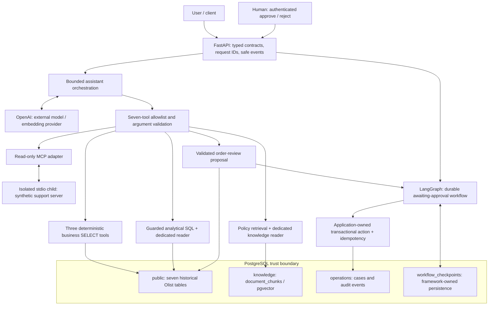

# Architecture and trust boundaries

The LLM selects among seven controlled capabilities and follows a bounded tool loop.
It is an agent because it can gather evidence through tools, combine evidence classes,
and propose a durable action workflow; it is not limited to generating chat text.
The model is not the security boundary and cannot approve its own proposal.

## Seven capabilities

| Tool | Responsibility / enforcement |
| --- | --- |
| `get_order_status_summary` | Application-owned factual SELECT |
| `get_customer_order_history` | Repeat identity (`customer_unique_id`), not order-associated `customer_id` |
| `get_order_financial_summary` | Independent item/payment aggregation; Decimal BRL values |
| `run_analytical_query` | SQLGlot AST guard, allowlisted historical tables, dedicated SELECT role, row/statement limits |
| `propose_order_review_case` | Validate intent and historical reference; no direct execution |
| `search_company_knowledge` | Parameterized pgvector retrieval over authored demo guidance with attribution |
| `get_support_context` | Fixed read-only MCP capability; strict DTOs and bounded subprocess lifecycle |

`knowledge_sources` and `external_sources` remain distinct. Retrieved documents and
ticket text are untrusted evidence, not authorization. The post-MCP capability scope
comes from the original user request; ticket instructions cannot expand it. Model
responses/reasoning objects stay inside the provider boundary.

## Persistence ownership

| Schema / tables | Owner, grain, and mutability |
| --- | --- |
| `public.customers` | Ingestion-owned immutable snapshot; one order-associated customer record |
| `public.category_translations` | Ingestion-owned category-to-English reference; not a mandatory product parent |
| `public.sellers`, `public.products` | Ingestion-owned seller/product records; identifiers are primary keys |
| `public.orders` | Ingestion-owned order snapshot with nullable lifecycle timestamps |
| `public.order_items` | One numbered item per order; composite key `(order_id, order_item_id)` |
| `public.order_payments` | One recorded payment entry; composite key `(order_id, payment_sequential)` |
| `operations.order_review_cases`, `operations.case_events` | Application-owned mutable action records and append-only business audit; written atomically after approval |
| `knowledge.document_chunks` | Explicit synchronization owns chunks/embeddings; runtime reader is SELECT-only |
| `workflow_checkpoints.*` | LangGraph owns four checkpoint tables; explicit setup; trusted workflow runtime persists transitions |
| `public.alembic_version` | Alembic revision bookkeeping, not an eighth Olist business table |

Historical tables use explicit initial `create_all()`; Alembic owns operations and
knowledge migrations. LangGraph owns its separate checkpoint setup. None runs on
application import/startup. CSV loaders validate the complete source, require an empty
target, insert in one transaction, and reconcile counts. Knowledge synchronization is
explicit and may remove stale chunks; it is not a read-only command.

## Security model and limits

Implemented controls include separate least-privilege analytics/knowledge readers,
no administrative fallback, read-only transactions, guarded SQL, a fixed read-only
MCP tool, proposal/execution separation, approval-key authentication, immutable
workflow proposals, idempotent transactional action writes, persistent checkpoints,
content-free events, secret-key redaction, request correlation, and bounded dependency
timeouts. Import and liveness paths perform no dependency work. Readiness does not
call OpenAI, launch MCP, initialize schemas, or resume workflows.
Malformed-request validation returns a fixed 422 message rather than echoing caller
input, exception context, or arbitrary field names. Its documented error shape remains
compatible; request IDs provide operational correlation.

This is a production-oriented portfolio architecture, not a fully production-secure
service. The shared approval key is not employee IAM; the bootstrap primary database
login is administrative and trusted setup/operation code still needs production role
separation. Synthetic tickets are not a real CRM. Prompt injection is reduced, not
solved; AST validation is not a complete sandbox. There is no multi-tenant authorization,
rate limiting, production secrets manager, distributed tracing/metrics backend, cloud
deployment, HA, or failover. Docker access itself is privileged; container environment
secrets are visible to someone controlling the Docker daemon.
Model routing/SQL generation is nondeterministic: invalid proposals can exhaust the
existing single correction opportunity and return a sanitized failure. Acceptance
demonstrates tested scenarios, not a guarantee every wording/model run will succeed.

Olist is historical/anonymized: it does not support real customer contact or present
operational status. Payments are recorded entries, not automatically revenue, refunds,
fraud, or settlement. Installments never multiply payment_value. Missing values remain
missing; categories can lack translations; postal prefixes stay text. Raw item/payment
joins can multiply totals. Product measurements retain grams/centimeters and the two
source spelling corrections are explicit. Demo policy documents are not official
Olist policies.
